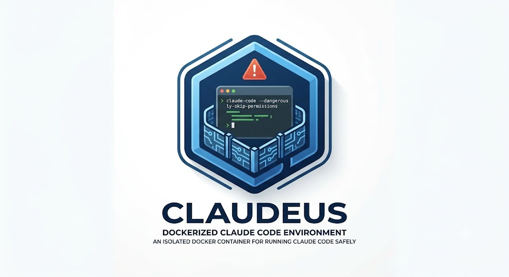

# Claudeus — Claude Code Sandbox

An isolated Docker environment for running Claude Code with `--dangerously-skip-permissions` without exposing the host machine. Based on Anthropic's reference devcontainer (`anthropics/claude-code`), adapted for Python/ML development: Python 3 + `uv` preinstalled, PyPI and Hugging Face allowed through the firewall, and optional Docker-in-Docker support via [sysbox](https://github.com/nestybox/sysbox).

**Tested on:** Ubuntu 26.04 LTS (kernel 7.0). It should work on any reasonably recent Linux distribution with Docker CE installed natively (not via snap) — the Dockerfile targets Debian/Ubuntu package tooling, and sysbox officially supports Ubuntu 18.04–24.04 and Debian Bullseye/Buster (see [Docker-in-Docker](#docker-in-docker-sysbox) for details on newer, untested distros).

## Table of Contents

- [What this gives you](#what-this-gives-you)
- [Installation](#installation)
  - [Option A — Plain Docker](#option-a--plain-docker-recommended-for-cli-use)
  - [Option B — VS Code Devcontainer](#option-b--vs-code-devcontainer)
- [GitHub access](#github-access-scoped-token-no-ssh-key)
- [Identity profiles](#identity-profiles)
- [Customizing the egress whitelist](#customizing-the-egress-whitelist-url_whitelistyml)
- [Read-only and hidden paths](#read-only-and-hidden-paths-projectclaudeus)
- [Self-test](#self-test-claudeus-selftest)
- [Docker-in-Docker (sysbox)](#docker-in-docker-sysbox)
- [Tools and reproducibility](#tools-and-reproducibility)
- [Do `deny` rules and hooks survive yolo mode?](#does---dangerously-skip-permissions-still-honour-a-projects-deny-rules-and-hooks)
- [Python customization](#python-customization)
- [Security considerations](#security-considerations)

## What this gives you

- **Isolation**: only the current project directory is mounted into the container. No `~/.ssh`, no cloud credentials, no access to the rest of the disk.
- **Egress firewall**: default-DROP policy, strict whitelist (Anthropic API, GitHub, npm, PyPI, Hugging Face, plus whatever you add). Even if compromised via a prompt injection, Claude cannot exfiltrate to an arbitrary domain — see [Security considerations](#security-considerations) for the limits of this guarantee.
- **Non-root user**: required by Claude Code for skip-permissions mode.
- **Persistent auth**: `~/.claude` lives in a named Docker volume, no re-authentication on every session.
- **Optional Docker-in-Docker**: with [sysbox](https://github.com/nestybox/sysbox) installed on the host, the sandbox can run its own isolated `dockerd` — Claude can `docker build`/`docker run` from inside the sandbox without `--privileged` or a host socket bind-mount.

## Installation

### Option A — Plain Docker (recommended for CLI use)

```bash
# Install (once)
git clone <this-repo-url> ~/tools/claudeus     # or: cp -r claudeus ~/tools/
chmod +x ~/tools/claudeus/claudeus
mkdir -p ~/.local/bin
ln -s ~/tools/claudeus/claudeus ~/.local/bin/claudeus   # make sure ~/.local/bin is on your PATH

# Daily use — pass the project path as the first argument
claudeus ~/projects/my-project          # Claude in autonomous mode (yolo, the default)
```

Other modes, and running from inside the project directory:

```bash
claudeus ~/projects/my-project yolo     # same as above, explicit
claudeus ~/projects/my-project claude   # Claude in normal mode (with prompts)
claudeus ~/projects/my-project shell    # bash shell in the container

cd ~/projects/my-project
claudeus                                # path omitted → uses the current directory
```

The interactive modes (`yolo`, `claude`, `shell`) need a terminal: when stdin is not one (script, CI, pipe), `claudeus` stops right away with an explicit error instead of starting a container that exits obscurely. Explicit commands still work without a terminal (`claudeus ~/projects/my-project claude -p "..."`, `selftest`, any `<command>`).

First run: builds the image (~2-3 min), then `claude` will ask you to authenticate. Auth is kept for subsequent sessions. If you edit the Dockerfile later, remove the stale image (`docker rmi claudeus`) so it gets rebuilt on the next run.

### Option B — VS Code Devcontainer

```bash
cp -r ~/tools/claudeus/.devcontainer ~/projects/my-project/
```

Then open the project in VS Code → "Reopen in Container". Once inside, open a terminal → `claude --dangerously-skip-permissions`.

## GitHub access (scoped token, no SSH key)

The idea: a revocable, narrowly-scoped token, never your SSH keys, inside the container.

1. **Create the token.** Which kind depends on who owns the repository the agent works on:

| Case | Token type | Why |
|---|---|---|
| (a) The token's account **owns** the repo (or the repo belongs to an org that allows fine-grained PATs) | **Fine-grained PAT** | Can be limited to selected repositories and minimal permissions. |
| (b) The token's account is only an **outside/repository collaborator** on someone else's personal repo (e.g. a dedicated "machine" account with Write access) | **Classic PAT**, scope `repo` only | GitHub documents that a fine-grained PAT can only reach repositories the token's user owns or where an organisation resource owner grants access — personal repos of another user, where you are a mere collaborator, are out of reach. |

**Case (a) — fine-grained PAT**: github.com → Settings → Developer settings → Personal access tokens → Fine-grained tokens → Generate new token.
   - Repository access: "Only select repositories" → only the repos you need
   - Permissions: Contents (Read and write), Pull requests (Read and write), Issues if needed
   - Expiration: 30 or 90 days

**Case (b) — classic PAT**: Settings → Developer settings → Personal access tokens → Tokens (classic).
   - Scope: `repo` only. **Never `workflow`.** (`public_repo` may be enough for a *public* repository — untested here; try it first.)
   - Expiration: short (7 to 30 days).

> **Warning — a classic `repo` token is a ceiling, not a filter.** It grants access to **every** repository the account can reach (all its own repos, and every repo where it is a collaborator or org member), not just the one you have in mind. Only use it with an account that has access to nothing else — a dedicated account with a single collaboration is the intended setup. If the account can see other private repos, use another approach.

2. **Store it on the host** (outside any repo):

   ```bash
   mkdir -p ~/.config/claudeus
   cat > ~/.config/claudeus/env <<'EOF'
   export GH_TOKEN="github_pat_XXXX"   # or ghp_XXXX for a classic token
   export GIT_USER_NAME="Your Name"
   export GIT_USER_EMAIL="you@email.com"
   EOF
   chmod 600 ~/.config/claudeus/env
   ```

3. **That's it.** `claudeus` sources this file automatically, passes the token into the container, and wires git to it via `gh auth setup-git`. Inside the container, `git clone/push`, `gh pr create`, etc. work out of the box. A project `remote` in SSH form (`git@github.com:` or `ssh://git@github.com/`) is rewritten to HTTPS by a **global git config inside the container** (`url."https://github.com/".insteadOf`, written at startup); the repository's own `.git/config` on the host is left untouched. The container has no SSH key, so only the token authenticates: pushes are performed as the account that owns `GH_TOKEN` (check with `gh api user --jq .login`).

For the VS Code devcontainer: export `GH_TOKEN` in your shell before launching VS Code (`devcontainer.json` picks it up via `${localEnv:GH_TOKEN}`).

If in doubt, or if the agent behaves suspiciously: revoke the PAT on GitHub, all access is cut instantly.

Expiry reminder: at each start, `claudeus` asks GitHub for the token's expiration date and prints a warning when the token expires within 7 days (or is already rejected/expired). Change the threshold with `CLAUDEUS_TOKEN_WARN_DAYS=14 claudeus ...`. It never blocks the session: without a token, without network, or with a classic token that has no expiration, it stays silent. (Not wired into the VS Code devcontainer.)

## Identity profiles

Several identities (e.g. your own, and a dedicated "machine" account for an agent) can coexist:

```bash
# ~/.config/claudeus/machine.env  (chmod 600) — same format as `env`
export GH_TOKEN="ghp_XXXX"
export GIT_USER_NAME="Machine account"
export GIT_USER_EMAIL="machine@example.com"
```

```bash
claudeus --profile machine ~/projects/my-project    # explicit
echo machine > ~/projects/my-project/.claudeus/profile   # or: the project picks a name
claudeus ~/projects/my-project
```

- Precedence: `--profile` > `<project>/.claudeus/profile` (one name, nothing else) > no profile (`~/.config/claudeus/env`, unchanged behaviour).
- A profile name is `[A-Za-z0-9_-]+`; a missing `<name>.env` is an error (never a silent fallback to another identity).
- With a profile, `GH_TOKEN` / `GIT_USER_*` of the calling shell are ignored: only the profile file counts.
- Each profile gets its **own Claude config volume** (`claudeus-config-<name>`; without profile: `claudeus-config`, as before), so Claude credentials of one identity are never visible from another. History and inner-Docker volumes stay shared.
- `GITHUB_TOKEN`, `GH_ENTERPRISE_TOKEN`, `GITHUB_ENTERPRISE_TOKEN` and `SSH_AUTH_SOCK` are explicitly unset by the script and never passed to the container, even if the shell or the env file defines them.
- `CLAUDEUS_CONFIG_DIR` overrides `~/.config/claudeus` (used for tests).
- **Allowed profiles (host side)**: `.claudeus/profile` lives in the project, which the agent can write, so it can only select a profile that *you* authorised for that project in `~/.config/claudeus/allowed-profiles`, one line per project: `<absolute project path> <profile>[,<profile>...]` (`#` comments allowed). Otherwise `claudeus` refuses (exit 2) and prints the line to add. `--profile`, typed by you, is not subject to this list. Paths are compared after resolving symlinks.

## Customizing the egress whitelist (`URL_whitelist.yml`)

The whitelist lives in [`.devcontainer/URL_whitelist.yml`](.devcontainer/URL_whitelist.yml), not buried in a shell script — edit it directly:

```yaml
domains:
  - registry.npmjs.org       # npm install
  - api.anthropic.com        # Claude Code
  - pypi.org                 # pip install

optional_domains:
  - sentry.io                 # Claude Code telemetry
```

- `domains`: required — the sandbox **fails to start** if one of these can't be resolved.
- `optional_domains`: best-effort — a resolution failure only logs a warning (useful for telemetry endpoints Claude Code can live without).

**No image rebuild needed.** The file is bind-mounted read-only into the container and re-read by `init-firewall.sh` on every startup — edit it, relaunch the sandbox, done. (A copy is also baked into the image as a fallback default, in case you're running the container without the bind-mount.)

### Per-project additions (`<project>/.claudeus/URL_whitelist.yml`)

A project can add domains without touching Claudeus. Same keys (`domains`, `optional_domains`), nothing else:

```yaml
# <project>/.claudeus/URL_whitelist.yml
domains:
  - api.example-registry.io   # needed by this project's build
optional_domains:
  - telemetry.example.io
```

`claudeus` **merges the two files on the host** (de-duplicated; a domain that is required anywhere is not repeated as optional) into a temporary file that is bind-mounted read-only on `/usr/local/etc/url-whitelist.yml`, and deletes it when the session ends. Why on the host: the project file lives in `/workspace`, which the agent can write; if the merge happened in the container, the agent could widen its own egress (the `node` user may re-run `sudo init-firewall.sh` mid-session). With the merged file read-only and outside the workspace, editing the project file during a session has no effect until the next launch.

Unknown keys and anything that is not a plain host name are refused (exit code 2), not silently ignored. Remember that the project file is *your* review point: read it before launching a project you do not fully trust.

`init-firewall.sh` can be re-run mid-session (for rotating CDN IPs): it then only rebuilds the IP set and swaps it in atomically, leaving the rules untouched.

**GitHub IP ranges**: `claudeus` reads `https://api.github.com/meta` **on the host** (with your authenticated `gh` if available, else anonymously), validates it, caches it for 24 h in `~/.cache/claudeus/github-meta.json`, and mounts it read-only in the container (`/usr/local/etc/github-meta.json`), where `init-firewall.sh` uses it instead of calling the API. No per-start API call, no anonymous quota (60 requests/hour per IP) to exhaust, and the file cannot be altered by the agent. If the host cannot fetch it, a stale cache is used with a warning; with no cache at all the container falls back to reading the API itself (anonymous quota applies; a failed start is fail-closed, a failed mid-session re-run keeps the current ranges). The ranges are therefore frozen for the session; delete the cache file to force a refresh. Not available with the VS Code devcontainer, which still reads the API in the container.

Golden rule: only whitelist what the project actually needs. Every domain added here is a potential exfiltration channel, even under prompt injection.

Note: the firewall resolves domains to IPs at container startup. For CDNs with highly dynamic IPs, you may need to re-run `sudo /usr/local/bin/init-firewall.sh` mid-session.

## Read-only and hidden paths (`<project>/.claudeus/`)

Two optional lists, one relative path per line (`#` comments and blank lines allowed):

```
# <project>/.claudeus/readonly-paths   — visible, but not writable
infra
.claude

# <project>/.claudeus/hidden-paths     — present on disk, unreadable in the container
.env
secrets
```

- `readonly-paths`: mounted `:ro` over `/workspace`.
- `hidden-paths`: a file is replaced by an empty read-only file (`/dev/null`), a directory by an empty read-only directory. `git status` in the container will show them as changed/deleted; that is expected.
- **`.claudeus/` itself is always mounted read-only** when it exists; do not list it.
- Paths that do not exist are skipped with a warning (Claudeus never creates empty folders on your host). Absolute paths, `..`, symbolic links anywhere in the path, and characters outside `A-Za-z0-9._@+/ -` are **refused** (exit code 2): a link created by the agent must not be able to expose a host path.
- Everything is resolved on the host at launch. If a project has no `.claudeus/` yet, an agent could create one (profile, whitelist, path lists) that would apply to the *next* launch: create the directory yourself (`mkdir .claudeus`) so it gets protected, and review it before launching.

Limits you should know about:

- **A single-file `:ro` mount breaks editors that replace by renaming** (`mv` onto a mounted file fails with "Device or resource busy"). Prefer protecting directories; for hidden files this is harmless.
- **`.git/config` cannot be read-only** (`git push -u` writes to it), so an agent can change `core.hooksPath` or add hooks in `.git/hooks`. Local git hooks only guard against *mistakes*; the real barrier is server-side (branch rulesets, required CI, token scope).
- Hiding a file hides it from the container only: if the same secret is elsewhere in a readable path (a copy, shell history, a Terraform state in another folder), it is not protected.
- Tested with sysbox-runc. Note that with sysbox a `--tmpfs` mount is applied *before* the `/workspace` bind mount and ends up shadowed, which is why directories are masked with an empty host directory (a temporary one, removed at the end of the session).

## Self-test (`claudeus selftest`)

```bash
claudeus [--profile <name>] ~/projects/my-project selftest [--require-github]   # exit code 0 = all good, 1 = first failure
```

Starts the container exactly like a normal session and checks, stopping at the first failure:

- no `~/.ssh`, no `~/.config/gh`; `GITHUB_TOKEN`, `GH_ENTERPRISE_TOKEN`, `GITHUB_ENTERPRISE_TOKEN`, `SSH_AUTH_SOCK` unset;
- a domain outside the whitelist (`https://example.com`) is unreachable; the mounted whitelist is read-only;
- re-running `sudo init-firewall.sh` leaves the iptables rules byte-for-byte identical to those of the initial setup, still uses the mounted whitelist file, and `sudo WHITELIST_FILE=… init-firewall.sh` is refused;
- `.claudeus/` and every `readonly-paths` entry is not writable; every `hidden-paths` entry is empty/unreadable;
- GitHub is **optional**: with a `GH_TOKEN`, `gh api user --jq .login` must return an account (the login is printed, never the token). Without one, these checks are reported `SKIP` and the summary says "GitHub non vérifié". Pass `--require-github` to make a missing token a failure (use it when the point is to prove which identity the agent has);
- `env -u GH_TOKEN gh auth status` fails: no `gh` login is stored behind `GH_TOKEN`.

The output is one line per check and contains no secret, so it can be pasted into a report. The test script is `.devcontainer/selftest.sh`, mounted read-only from the host (no image rebuild). It cannot prove the *absence* of leaks it does not look for: it is a regression net, not an audit.

## Docker-in-Docker (sysbox)

Claude may need to build or run containers from inside the sandbox itself (image builds, integration tests...). Rather than `--privileged` or a bind-mount of the host's Docker socket — both of which would defeat the isolation this repo is built around — the sandbox uses [sysbox-runc](https://github.com/nestybox/sysbox): a container runtime that lets an inner `dockerd` run fully isolated from the host's Docker daemon via a complete user-namespace, without elevated host privileges.

### Prerequisites (host, one-time)

```bash
docker stop <any running containers, if needed>   # installing sysbox restarts the host Docker daemon
sudo cp /etc/docker/daemon.json /etc/docker/daemon.json.bak
wget https://github.com/nestybox/sysbox/releases/download/v0.7.1/sysbox-ce_0.7.1.linux_amd64.deb
sudo apt-get install -y jq
sudo apt-get install -y ./sysbox-ce_0.7.1.linux_amd64.deb
docker info | grep -i sysbox   # should list sysbox-runc
```

Officially supported: Ubuntu 24.04 (Noble, kernel 6.8+), 22.04, 20.04, 18.04, Debian Bullseye/Buster. This setup has been validated on **Ubuntu 26.04 (kernel 7.0)**, which is newer than sysbox's official compatibility matrix but works fine with the generic `.deb` package. On other recent distros it should work too, but isn't guaranteed — if the package fails, see [nestybox/sysbox](https://github.com/nestybox/sysbox) for a from-source build.

### What changes

- `claudeus` and the devcontainer launch the container with `--runtime=sysbox-runc` (no more `--cap-add=NET_ADMIN`/`NET_RAW`: sysbox already grants root the capabilities it needs inside its own user-namespace).
- An inner `dockerd` starts automatically when the sandbox launches. `docker build` / `docker run` work directly from inside the sandbox.
- Inner Docker images/layers persist in a dedicated named volume (`claudeus-dind` for the CLI script, `claudeus-dind-${devcontainerId}` for the devcontainer), separate from the host's own `/var/lib/docker`.
- **The egress whitelist also applies to nested containers**: `init-firewall-dind.sh` populates the `DOCKER-USER` chain (the insertion point Docker provides for exactly this kind of rule, evaluated before its own permissive bridge rules) with the same `allowed-domains` ipset as the sandbox itself. A container launched from inside the sandbox can't exfiltrate to a domain outside the whitelist either.

### Known limitation: multiple GPUs

sysbox's GPU passthrough currently has a documented bug with **multi-GPU hosts** ([nestybox/sysbox#901](https://github.com/nestybox/sysbox/issues/901)): GPU access works reliably on single-GPU machines but is not reliably supported when the host has more than one GPU. If your workload needs multi-GPU access from inside the sandbox, this is not currently guaranteed to work — test before relying on it, and consider running without sysbox (and without inner DinD) for multi-GPU workloads.

## Tools and reproducibility

- **Pinned versions**: the image builds Claude Code `2.1.325` and `mise` `v2026.11.9` (no more `latest`). Change them with build arguments: `docker rmi claudeus; CLAUDE_CODE_VERSION=x.y.z claudeus <project>` or `docker build --build-arg CLAUDE_CODE_VERSION=x.y.z --build-arg MISE_VERSION=vYYYY.M.P -t claudeus .devcontainer`. `mise` is downloaded as a release binary and verified against SHA-256 sums pinned in the Dockerfile (`MISE_SHA256_X64` / `MISE_SHA256_ARM64`, from the release's `SHASUMS256.txt`); when you change `MISE_VERSION`, update both sums or the build fails.
- **`mise`** is installed as a generic tool; Claudeus ships none of a project's tools. Each project runs its own `mise install` (or `mise use node@22`). Its shims come first in `PATH`, so a mise-managed `node`/`python3` replaces the image's Node 20 / Python 3.11 for that project (tested: `mise use node@22` → `node v22`, and `claude` still runs under it).
- **Persistent tool store (`mise` volume)**: tools installed by `mise` live in a named Docker volume, so a project's tools are installed once instead of at every session (the container itself is throwaway). The volume is **per profile and per project**: `claudeus-mise-<profile|default>-<8 hex of the project's real path>`, mounted on `/home/node/.local/share/mise`. A tool installed for one project is never visible to another, nor to another identity. Moving or renaming the project directory gives it a new (empty) volume.
  - **Trade-off, please read**: what is installed stays installed. If a tool (or a `node`/`python3` shim, which sit first in `PATH`) is compromised during a session, it is still there next session of the same project. The firewall limits where tools come from; it does not clean the store.
  - `claudeus --fresh-tools <project>`: no volume, everything is reinstalled each session (use it for projects you trust less).
  - Reset after a suspicious session: `docker volume ls | grep claudeus-mise` then `docker volume rm <name>` (the volume is only used by a running container if you stop it first).
  - **Size and growth** (measured 2026-11-17 with `aqua:cli/cli`): about 49 MB per installed version of `gh`; the download archives are not kept; two versions installed side by side took 98 MB. Nothing caps the volume: every version a session installs stays until pruned, so a project that bumps versions often grows over time. Check a volume's size with `docker run --rm --entrypoint du -v <name>:/v claudeus -sh /v` (list the names with `docker volume ls | grep claudeus-mise`). Remove versions no config file references with `mise prune` inside a session (careful: in a project without `mise.toml`, it removed every installed version), or delete the volume as above.
  - Needs an image rebuild once (`docker rmi claudeus`): the Dockerfile now creates the directory, owned by `node`, so the volume inherits correct ownership.
- **mise needs network access that the default whitelist does not give**, by design (only what a project needs). Add them in `<project>/.claudeus/URL_whitelist.yml`:
  - Node: `nodejs.org`.
  - Python: `mise-versions.jdx.dev`, `release-assets.githubusercontent.com`, `objects.githubusercontent.com` (tested with `python@3.12`; without them the install fails with "Network is unreachable").
  - **Attestations are disabled** (`MISE_AQUA_GITHUB_ATTESTATIONS=false` in the image): verifying GitHub artifact attestations for `aqua:` tools needs `tmaproduction.blob.core.windows.net`, a shared Azure storage host. The firewall filters by IP, so allowing it would also open other Azure storage accounts (a possible exfiltration channel). Without this setting, `mise install aqua:<tool>` fails (tested with `aqua:cli/cli@2.60.0`). The trade-off: no provenance check on tools installed through aqua. Needs an image rebuild (`docker rmi claudeus`).
  - Other tools: check with `MISE_VERBOSE=1 mise install <tool>` which hosts it contacts. The firewall resolves IPs at startup, so a tool served by a rotating CDN may need `sudo init-firewall.sh` again.
- **What can get in the way of replacing Node/Python**: (1) Claude Code itself runs on whatever `node` comes first in `PATH`; replacing it with a version Claude Code does not support (it needs a recent Node; 20 and 22 were tested) breaks `claude`. (2) `mise` asks to trust a project's `mise.toml` (`mise trust`), and the file lives in the writable workspace. (3) Base-image tools that call `python3` (none of Claudeus's scripts do) would see the mise one.

## Does `--dangerously-skip-permissions` still honour a project's `deny` rules and hooks?

**Yes, both are honoured (tested 2026-11-16, Claude Code 2.1.325, `claude -p --dangerously-skip-permissions`, model haiku).** A project's `permissions.deny` rule blocked its command, and a `PreToolUse` hook ran for every Bash call and blocked another one (exit code 2). Evidence independent of what the model says: of three commands that each create a file, only the unrestricted one's file exists; the hook's witness file lists all three commands. One run per configuration, one tool (Bash), one Claude Code version: re-run the test after upgrading.

[`tests/skip-permissions.sh`](tests/skip-permissions.sh) generates a throw-away project in a temp directory with a `permissions.deny` rule on one harmless `echo`, a `PreToolUse` hook that writes a witness file and blocks another harmless `echo`, then runs `claude -p --dangerously-skip-permissions` through `claudeus` and prints what ran and what the hook saw:

```bash
claudeus ~/some/dir claude        # once, if needed: log in again, then exit
tests/skip-permissions.sh [--profile <name>]
```

**Still, treat them as a guard against mistakes, not a barrier.** `.claude/settings.json` and the hook scripts live in `/workspace`, which the agent can write: unless they are covered by `readonly-paths` (add `.claude`), an agent can edit its own rules for the next session, and `.git/config` cannot be read-only (see above). The real barriers are the mounts, the firewall and server-side controls.

## Python customization

The Dockerfile installs Python 3 (Debian bookworm → 3.11) and `uv`. Inside the container:

```bash
uv venv && source .venv/bin/activate
uv pip install -r requirements.txt
```

To pin a specific Python version or add system libraries (e.g. `ffmpeg` for TTS work), edit the `apt-get install` block in the Dockerfile.

## Security considerations

### Risk of `--dangerously-skip-permissions`

The `yolo` mode runs Claude Code with all permission prompts disabled — every tool call (file edits, shell commands, network requests within the whitelist, git operations) executes without asking for confirmation. This is what makes the sandbox necessary in the first place: it trades human-in-the-loop review for containment. Concretely, this means:

- A single bad decision by the model — misinterpreting a task, following a manipulated instruction, or simply making a mistake — can execute immediately and irreversibly *inside the container* (deleting files, force-pushing, running destructive commands) before you have a chance to notice.
- Anything reachable from inside the container is fair game: the mounted project directory, whatever's in the whitelisted network destinations, and the credentials explicitly passed in (`GH_TOKEN`, git identity).
- Review `git diff` regularly during long autonomous runs, and treat the scoped GitHub PAT as your kill switch — revoking it on GitHub cuts access instantly if something looks wrong.

Never run `yolo` mode directly on the host, outside this sandbox (or an equivalent isolation layer) — the same skip-permissions flag without containment gives the model unrestricted access to your real filesystem, credentials, and network.

### Prompt injection via external resources

Claude Code fetches and reads content from outside the conversation as part of normal operation: web pages, file contents, command output, API responses, README files, issue/PR text, package metadata, etc. Any of that content can contain text engineered to look like instructions — a prompt injection. If the model treats injected text as a legitimate command, it can attempt actions the user never asked for, using whatever tools and access are available to it in that moment.

The sandbox does not prevent prompt injection from happening — it limits what a successfully injected instruction can *do*:

- Filesystem access is limited to the mounted project directory — no `~/.ssh`, no cloud credentials, no access to the rest of the host disk.
- Network egress is limited to the whitelist in `URL_whitelist.yml` — a compromised agent can't exfiltrate data to an arbitrary attacker-controlled domain, and (with DinD/sysbox) neither can containers it spawns inside the sandbox.
- Credentials exposed inside the container are limited to what you explicitly pass in (scoped GitHub PAT, git identity) — never your full SSH key or long-lived cloud credentials.

This significantly reduces the blast radius but does not eliminate the risk — see the next section for what remains.

### What sandboxing does not eliminate

- **The container protects the host, not what's inside the container.** A malicious or compromised project can read everything mounted into it, including Claude's own credentials in `~/.claude`. Reserve this setup for trusted repositories.
- **The whitelist is a domain list, not content inspection.** Anything reachable *within* a whitelisted domain (e.g. an attacker-controlled npm package, a malicious PyPI release, a compromised Hugging Face repo) is still reachable — the firewall stops exfiltration to new destinations, it doesn't vet the content coming from allowed ones.
- **Data already inside the container can leave through whitelisted channels.** If GitHub is whitelisted (it needs to be, for git operations) and the agent's scoped PAT has write access, a sufficiently manipulated agent could still push data to a repo it has access to. Keep the PAT's repo scope as narrow as possible.
- **GitHub is whitelisted as a whole.** The firewall allows every IP range published by `api.github.com/meta`, not just the repo you work on. A token that can write anywhere else (see the classic `repo` warning above) lets a manipulated agent push data to *another* repository. The firewall cannot tell repositories apart: the only real limit is what the token itself can reach.
- **Never mount host secrets** (`~/.ssh`, `~/.aws`, production `.env` files). Prefer scoped, short-lived tokens (e.g. a fine-grained GitHub PAT).
- **No system is 100% immune.** Isolation reduces the blast radius; it does not eliminate it. Monitor what Claude does, especially on long-running tasks: `git diff` before committing, container logs if something looks off.
